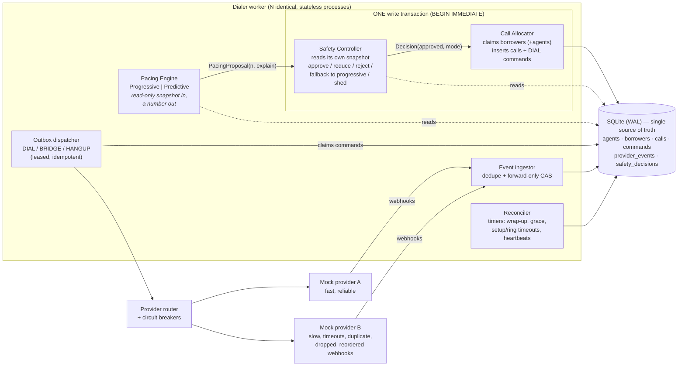
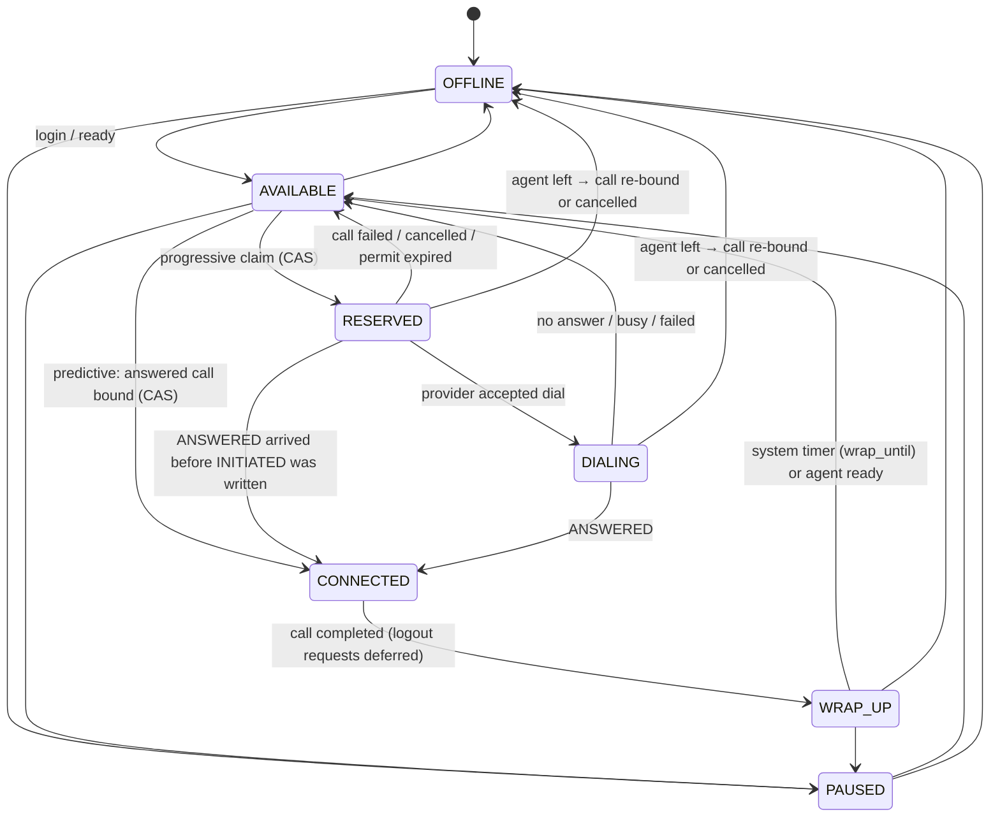
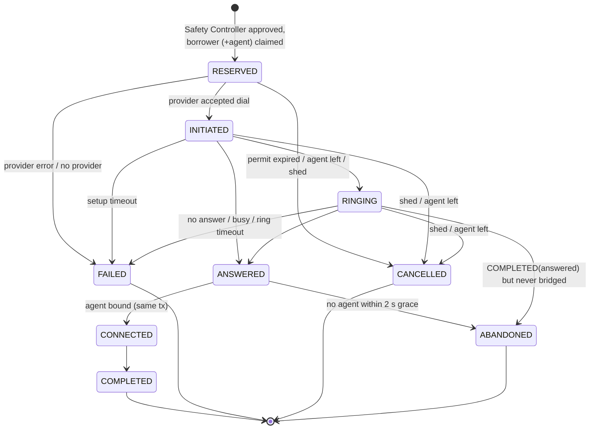

# SmartDialer architecture

## 1. Diagram



Plain-text version of the same thing:

```
Campaign (borrowers table)
   │
   ▼
Pacing Engine ──"I think 15 more"──▶ ┌──────────── one DB write transaction ───────────┐
 (no DB writes,                      │ Safety Controller ──Decision──▶ Call Allocator   │
  no provider handle)                │  own snapshot, own stats,       claim borrower,  │
                                     │  frozen config                  claim agent (P), │
                                     │                                 INSERT call,     │
                                     │                                 INSERT DIAL cmd  │
                                     └──────────────────────────────────────────────────┘
                                                        │ commit
                                                        ▼
                         Outbox dispatcher (lease) ──▶ Provider router ──▶ Telecom provider A / B
                                                                               │ webhooks (any order,
Reconciler (timers) ──CAS──▶ DB ◀──CAS── Event ingestor ◀─────────────────────┘  any number of times)
```

The pipeline in the brief (`Campaign > Pacing Engine > Safety Controller > Call Allocator > Telecom Provider`) is preserved exactly. The one structural choice that matters: **the Safety Controller decision and the allocator's writes happen in the same serialised DB transaction**, and the provider is only ever contacted for rows that transaction created.

## 2. Why there is no separate "cache", queue or coordinator

Every worker is identical and stateless; all coordination happens through compare-and-set writes on one database. That gives:

* agent and borrower allocation that is correct with any number of workers, with no leader election;
* crash recovery that is "another worker notices an expired lease or timer", because nothing important lives in worker memory;
* one place to look when debugging (every decision is a row in `safety_decisions` with its full reasoning).

The cost is that the database is the throughput ceiling. Section 9 says exactly where that bites and what to do about it.

## 3. Agent state machine



Notes
* `RESERVED`, `DIALING`, `CONNECTED` always carry `agents.call_id`, and the call row carries `agent_id` back. `invariants.check()` verifies both directions continuously in the simulator.
* An agent who logs out while `CONNECTED` is not cut off: `pending_state` is applied when the call ends.
* Lost heartbeat (15 s) is treated exactly like logout.
* **Wrap-up is system-timed** (`wrap_until`). That makes its end a fact rather than a forecast, which the Safety Controller uses (section 7).

## 4. Call state machine



The rule that makes it robust is in `states.py`: every state has a **rank**, non-terminal states only move to a *higher* rank (skips allowed), and terminal states are absorbing. Every write is `UPDATE calls SET state=? WHERE id=? AND state=<the state I read>`.

| Provider sends | What happens |
|---|---|
| `ANSWERED, ANSWERED, ANSWERED, COMPLETED` | First ANSWERED: call+agent CONNECTED, BRIDGE queued. 2nd: same `event_id` → `duplicate_delivery`, nothing touched. 3rd with a new id: ANSWERED→ANSWERED not allowed → `ignored_stale`. COMPLETED: COMPLETED, agent WRAP_UP. One bridge sent. |
| `COMPLETED, ANSWERED, RINGING` | COMPLETED(answered=true) on a never-bridged call → **ABANDONED** (the borrower heard silence; we count it honestly) and the agent is released. ANSWERED on a terminal call → no transition, a HANGUP is (re)armed in case the line is live, recorded as `late_answer_on_terminal`. RINGING → `ignored_stale`. |
| `RINGING` while we still show RESERVED | The worker died between `dial()` and writing INITIATED: the event adopts the call (RESERVED→INITIATED→RINGING, agent→DIALING). |
| `FAILED` after `ANSWERED` | Contradicts what we know; ignored, COMPLETED or the reconciler closes it. |
| Worker crashes right after ANSWERED | Either it crashed before COMMIT (nothing happened, provider redelivers, applied once) or after (state is durable, redelivery is a `duplicate_delivery`, the BRIDGE command sits in the outbox and any worker executes it once the 2 s lease expires). When COMPLETED arrives, it is processed normally. Tested in `tests/test_events.py`. |

## 5. Two workers, one AVAILABLE agent

```sql
UPDATE agents SET state='RESERVED', call_id=:call, version=version+1, state_since=:now
WHERE id = (SELECT id FROM agents WHERE state='AVAILABLE' ORDER BY state_since LIMIT 1)
  AND state = 'AVAILABLE'
RETURNING id;
```

1. Both workers may *read* the agent as AVAILABLE. Reading is not reserving.
2. The reservation is the `UPDATE ... AND state='AVAILABLE'`. The database applies the two updates one after the other. The second one re-evaluates the WHERE clause against the committed row, finds `RESERVED`, matches **zero rows**, and that worker simply gets no agent (or the next one).
3. Belt and braces: a partial unique index `one_active_call_per_agent ON calls(agent_id) WHERE state IN (active states)` makes a double booking impossible to *commit* even if application code were wrong. Same for borrowers.
4. In this prototype all of that also runs under `BEGIN IMMEDIATE`, so the whole decide-and-claim block is serialised; `tests/test_concurrency.py::test_cas_without_lock_two_readers_one_winner` shows the CAS alone is enough even without that lock, and `test_processes_never_overbook_agents` runs 8 OS processes against 20 agents.

In PostgreSQL the same statement works as-is (the second UPDATE blocks on the row lock, then re-checks the predicate under READ COMMITTED and matches nothing), and you'd use `FOR UPDATE SKIP LOCKED` in the sub-select so workers don't queue behind each other on the same "longest idle" agent.

**"The DB says AVAILABLE, the cache says RESERVED. Which wins?"** The database, always. There is no cache in the write path. If one were added for dashboards or for a pacing hint, it would be allowed to be stale in *both* directions, because the only operation that can reserve is the CAS above against the DB.

## 6. Crash recovery and idempotency

| Mechanism | Covers |
|---|---|
| **Transactional outbox** (`commands` table, written in the same tx as the state change) | We never "decide to dial" without recording it, and never record it without eventually doing it or explicitly giving up. |
| **Leases** on commands (`owner`, `lease_until`, 2 s) | A worker that dies holding a command loses it after 2 s; any worker picks it up. |
| **Our call id is the provider idempotency key** | Re-running DIAL after a crash or timeout returns the existing provider call instead of ringing the borrower twice (`duplicate_dial_requests` in provider stats). |
| **Provider pinned before first dial** | A timed-out dial may be ringing at provider A; retries for that call go to A only. Only *new* calls fail over. |
| **Permit TTL** (5 s) | An approval is only valid briefly. A DIAL picked up later than that is never sent: we ask the provider if it already exists (adopt it) or cancel and release the agent. Capacity assumptions can't be cashed in late. |
| **Event inbox** (PK `provider, event_id`) + forward-only CAS | At-least-once webhooks are applied at most once, in any order. |
| **Reconciler** timers (any worker, CAS) | wrap-up end, 2 s abandon grace, setup timeout (with provider lookup), ring timeout, lost heartbeats, very long calls. |

Walkthrough of the brief's case (`python -m smartdialer.demos crash`):

```
t+0.0  w0 reserved agent+borrower, provider ACCEPTED the dial, then w0 died before writing INITIATED
       call=RESERVED agent a0=RESERVED borrower=IN_CALL outbox=[DIAL:PENDING@w0]
t+0.5  w1 ticks: DIAL is still leased by dead w0, nothing to do
t+2.2  w0's lease expired; w1 re-runs DIAL with the SAME idempotency key
       provider dial requests=2, real calls at provider=1
       call=INITIATED agent a0=DIALING borrower=IN_CALL outbox=[DIAL:DONE]
t+2.2  ANSWERED arrives → CONNECTED, BRIDGE done; COMPLETED → agent WRAP_UP, borrower DONE
variant: down for 10 s → approval stale → ask provider: exists → adopt (no re-dial)
variant: died BEFORE dialling → provider never heard of it → CANCELLED, agent AVAILABLE, no attempt charged
```

If webhooks arrive while the worker is down they go to any other worker (in production: a load-balanced HTTP endpoint), so the call keeps progressing even before the lease expires.

## 7. Predictive pacing and the Safety Controller

### Pacing engine (proposes)

```
H             = average dial→answer time (observed)
expected_free = available now
              + agents whose system-timed wrap-up ends within H
              + Σ over live calls of P(talk ends and wrap-up is done within H)   [memoryless: 1 − e^−(H−wrap)/talk]
in_flight     = Σ over unbound calls already ringing of P(answer | still unanswered at its age)
need          = expected_free − in_flight
n             = need / p  × aggressiveness(abandon-rate feedback)    capped at 5× expected_free
```

`P(answer | unanswered at age a) = p·S(a) / (p·S(a) + 1 − p)` where `S(a)` is the empirical share of answered calls that took longer than `a`. A call that has rung for 25 s when almost everyone who answers does so within 15 s is very unlikely to answer. Counting it at full `p` wastes agents, and that turned out to be where much of the utilization gain comes from.

`python -m smartdialer.explain B --at 600` prints one real decision:

```
PACING ENGINE (predictive) proposed: 16
  answer rate p           = 0.471  (from short_window)
  horizon H (dial->answer) = 11.7s, avg talk = 79.2s
  free now                 = 9
  + wrap-ups ending in H   = 4
  + talks ending in H      = 1.83
  = expected free agents   = 14.83
  - expected answers from 39 calls already ringing = 7.64
  = need                   = 7.2  ->  need / p = 15.27
  x aggressiveness 1.1 (abandon rate 0.0), cap 35.2  ->  n = 16

SAFETY CONTROLLER: REJECT  requested=16 approved=0 mode=predictive
  its own capacity         = available 9 - answered waiting 0 + wrap-ups certainly done before earliest answer 4 = 13
  answer rate it trusts    = max(UCB short 0.524, UCB long 0.51) = 0.524
  P(answers > capacity)    = 0.0225 now
```

So "why 17 and not 10?" always has an itemised answer, and so does "why did the controller only allow 3?".

### Safety Controller (decides)

It never uses the pacer's numbers except the requested count. Inside the allocation transaction it reads its own snapshot and applies, in order:

1. **All providers DOWN** (every breaker open) → `REJECT`.
2. **Provider DEGRADED** (half-open) → progressive, max 2 probe calls per decision.
3. **Progressive request** → `min(requested, available − answered_waiting − unbound_in_flight)`: one agent per call, counting every unbound call still in flight as needing an agent (worst case).
4. **Fallback to progressive** if any of: fewer than 50 resolved attempts of history; rolling 30-min abandon rate ≥ 80% of the 3% ceiling; anyone answered and waiting for an agent right now; short-window answer rate significantly above long-window (z > 3, "answers are rising").
5. **Predictive bound.**
   * `capacity = available − answered_waiting + agents whose wrap-up certainly ends before the earliest plausible answer (+2 s grace)`. Talk-time endings are *not* counted, because they're a forecast.
   * `p_safe = max(Wilson upper bound of short window, of long window)`: conservative whether the answer rate is rising or falling.
   * Every in-flight unbound call gets its age-adjusted `P(answer)`. New calls get `p_safe`. Their sum is a Poisson-binomial; add calls one at a time while `P(answers > capacity) ≤ ε` (2% per decision, halved when the abandon rate passes 50% of the ceiling). Exact DP up to 400 free agents, normal approximation above.
   * Hard cap: unbound calls ≤ 3 × capacity.
6. **Shed.** If capacity collapses (agents vanish), and the risk for calls *already* ringing exceeds 5%, cancel the newest unanswered ones (they have the highest answer probability) until it doesn't.

**Why the pacer can't switch it off:** `pacing.py` imports nothing that writes or dials (a test parses its imports). The allocator is the only code that inserts calls, it calls `SafetyController.authorize()` itself inside its transaction, and it inserts exactly `decision.approved` rows. The controller uses `__slots__`, its config is a frozen dataclass behind a read-only property, and the provider only sees rows that went through this path, within a 5 s TTL.

### "Predicted 70%, suddenly 10%"
Fewer answers is the *safe* direction: agents idle, nobody gets abandoned. The pacer's short-window estimate drops within ~2 minutes and it asks for many more calls. The controller keeps using `max(UCB short, UCB long)`, so until the 15-minute window has caught up it still assumes ~70% and approves only what would be safe at 70%. Utilization dips for a while; safety doesn't. The dangerous direction (10% → 70%) trips the drift rule and forces progressive within the short window, and anyone answered-and-waiting forces progressive immediately. Scenario D does both (results in `docs/RESULTS.md`).

## 8. Failure handling summary

| Case | What the system does | Demo / test |
|---|---|---|
| Worker crash mid-call-setup | Lease expiry + idempotent re-dial, or adopt/cancel if the approval is stale. Events are handled by any worker in the meantime. | `demos crash`, `test_failures.py`, scenario `worker_crash` |
| Provider outage | Existing calls: no events → setup/ring timeouts → FAILED + HANGUP (retried, then DEAD for ops). Webhooks held by the provider are redelivered late and absorbed. New calls: breaker opens after 8 samples at ≥50% failure → `REJECT`; failover to B if configured. Retries: borrowers get `system_failures` + exponential backoff, no attempt charged. Pacing: half-open → progressive, 2 probes per decision → CLOSED → predictive once statistics allow. | `demos outage`, scenarios `outage`, `outage_failover` |
| 40 of 100 agents vanish in 3 s | Logged-out agents' setup calls are re-bound or cancelled immediately. Next tick (≤1 s) the controller sees the new capacity: approvals go to 0, and the newest unanswered calls are shed until risk is back within bounds. | `demos agent_drop`, scenario `agent_drop` |
| Duplicate events | Inbox PK for retries; rank rule for semantic duplicates. One transition, one bridge. | `demos duplicates`, `test_events.py` |
| Out-of-order events | Rank rule; terminal states absorbing; late ANSWERED on a dead call → hangup + counted as abandon. | `demos out_of_order`, `test_events.py` |

An honest note on outages: answered calls that can't be bridged because the provider is down are abandons in reality and are counted. Predictive has more calls in flight when the outage hits, so it takes more of them, and the abandon budget then keeps it in progressive mode until the window clears. Two things limit the damage: (1) **new calls are spread round-robin across every healthy provider** (`providers/router.py`), so when one of two providers dies suddenly only ~half the in-flight unbound calls are riding on it — in the `outage_failover` scenario this holds utilization at ~71% with a 1.4% abandon rate through the outage, versus ~61% / 3.6% when all calls were routed to one provider; (2) the circuit breaker stops sending *new* calls to the failing provider within ~11 s. The remaining production step is an explicit per-provider ceiling on concurrent unbound calls so the blast radius is a hard number, not just a share.

## 8a. Finding bugs: the randomized fuzzer

`tests/test_chaos.py` is the "Break" step. Over 240 seeds it drives the real dialer through a hostile environment — provider events delivered in random order, duplicated, and dropped; worker crashes before and after the event commit (in-memory state lost); agents logging out, back in, and losing heartbeats; multiple workers on one database — and asserts the global invariants after **every** step, then drains to a fully consistent terminal state (every call terminal, every borrower released, every agent at rest, every answered borrower either connected or counted as an abandon, never silently lost).

It earned its keep immediately: it found that call-id generation used a per-worker seeded PRNG, so a crashed worker that restarted (or two same-named workers) could regenerate an id sequence and collide, and the `UNIQUE` constraint on `calls.id` then aborted the whole allocation transaction. Fixed by switching to truly-random ids (`uuid4`); call ids are opaque, so simulation *behaviour* stays reproducible. This is exactly the class of bug that unit tests with hand-picked inputs miss.

## 9. Scale: 100 → 1,000 → 10,000 agents

Rough load: a call takes ~5 DB write transactions (allocate share, dial result, ringing, answer, end). At 10,000 agents, 100 s average handle time and a 3:1 dial ratio, that's ~300 dials/s and ~1,500 write tx/s, plus snapshot reads.

**What breaks first, in order:**

1. **The Safety Controller's exact math** (fixed already). Exact Poisson-binomial is O(in-flight × capacity): 2 ms at 100 free agents, ~190 ms at 1,000, **~27 s at 10,000** per decision (`scripts/loadtest.py` part 2). Above 400 free agents the controller now uses a normal approximation (O(1) per call, 3 ms at 10,000, matching exact to the 3rd decimal at the 2% tail). Found by load-testing, not by guessing.
2. **The snapshot, not the writes.** Every decision runs `COUNT`/`AVG` queries over the last 15–30 minutes of calls and lists every in-flight call's age. At 10,000 agents that's ~100k rows scanned per decision, several decisions per second per worker. Fix: maintain the numbers incrementally (counters + per-bucket histograms updated in the same transactions that change call state), so a decision reads O(1) rows.
3. **The single serialisation point per campaign.** The decide-and-claim transaction must be serialised *per pool of agents* for the safety guarantee to hold. With one SQLite file it's global; in my load test that's ~600 full calls/s (~4,000 write tx/s) on a laptop, flat from 1 to 8 processes: adding workers doesn't help because they queue on the same lock. That's enough for ~1,000 agents with headroom, and not for 10,000. Fix: **shard by agent pool**, not by worker. Each campaign/pool is owned by one allocator at a time (a lease row), PostgreSQL with row-level locking instead of a file lock, and `SKIP LOCKED` claims. Different pools never contend. Event ingestion and the outbox are naturally partitionable by call id.
4. **Telecom limits** (carrier CPS, concurrent channels per trunk) are the real-world ceiling long before CPU: 300 dials/s needs several trunks/providers, and per-provider in-flight caps become part of the Safety Controller.

**The statistical trade-off of sharding:** predictive dialing gets *better* with bigger pools (variance grows like √n, so the safety margin shrinks relative to capacity). Splitting 10,000 agents into 100 pools of 100 throws some of that away. The right shard is the largest pool one allocator can serve, not the smallest one that removes contention. At 100,000 agents the first thing to break is organisational, not technical: one campaign won't have 100k agents, so pools map to campaigns/teams naturally.
